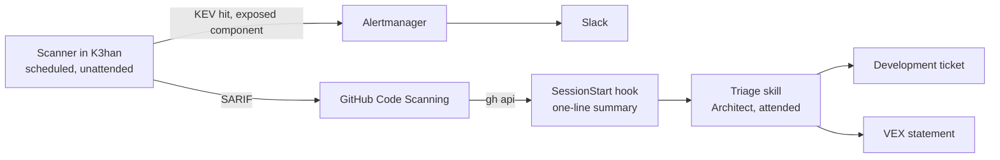

# K3han Operations (Script)

> **Type**: Script
> **Focus**: How the K3han platform is kept running: which work is proactive or reactive, cluster or host, and what carries each step of detection and triage.
> **Constraint**: A fix is a Development ticket and follows the [Development](safechord.kdd.practice.development.md) page. Alert routing is on the [monitoring page](safechord.chorde.k3han.monitoring.md); values stay in the manifests.

> **🚧 Draft.** Nothing on this page runs yet. It holds what the Architect has decided, and marks the rest as open decisions. This is Chorde's operations implementation page: the [Operations](safechord.kdd.practice.operations.md) mode page draws up what holds for both SafeZone and Chorde once both run.

---

## 1. Objective & Scope

Two criteria sort K3han operations work.

- **Proactive or reactive: is something wrong now?** Proactive work keeps the platform from breaking while nothing is broken; reactive work starts when something is. A CVE is proactive unless there is evidence that it is exploited against an exposed component, when it becomes reactive (§3.3).
- **Cluster or host: where is the desired state declared?** Cluster: in `Chorde/gitops/`, applied by ArgoCD. k3s is cluster work, because its upgrade is a System Upgrade Controller Plan there. Host: in `Chorde/cluster/k3han/ansible/`, applied by the playbook or the node's package manager: OS packages, kernel, sysctl, Tailscale. An item is classified by where its action lands, not where its detection runs: node patch state is measured in the cluster and is host work.

The workstation toolchain (argocd, helm, kubeseal, promtool, logcli) is in neither layer; its versions follow the cluster's.

Open decision: the reactive side (triage entry, mitigation runbooks) and host-layer detection are not designed.

## 2. Actors & Tools

| Actor / Tool | Responsibility | Type |
| :--- | :--- | :--- |
| **Scanner in K3han** | Scans the images running in the cluster on a schedule | Automation, unattended |
| **GitHub Code Scanning** | Holds each finding's state (open, fixed, dismissed) across scans | Service |
| **Alertmanager → Slack** | Carries the urgent lane (§3.3) | Automation, unattended |
| **SessionStart hook** | Summarises open findings when a Claude Code session starts | Automation, human-woken |
| **The Architect**, with a triage skill | Decides each new finding (§3.2) | Human, attended session |
| **Development** | Fixes, through a ticket | Mode |

## 3. Proactive Detection and Triage

Every proactive item runs detect → triage → ticket → Development. Operations owns detection, triage and live actions; it does not own the fix.

### 3.1 Detection

- **The scanner runs inside K3han**, unattended, on a fixed schedule, and scans the images that are running rather than those declared in `gitops/`: what runs is what is exposed. It never runs on `gce-agent-tw`, whose allocatable memory is about 1 GiB.
- **Findings go to GitHub Code Scanning as SARIF**, which keeps each finding's state across scans: an alert closes when a scan no longer reports it, reopens when it returns, and keeps its dismissal. Its alerts are not readable by the public on a public repository (tested on Chorde, 2026-09-09).
- **The scanner uploads with a GitHub token**, stored as a SealedSecret ([Security](safechord.security.md)).

Open decisions:

- The scanner's form (trivy-operator, or a CronJob running trivy) and its schedule.
- **SARIF identity.** Code Scanning keys an alert on a rule and a file location in the repository; a triage unit is one component version, which may carry several CVEs and one fix. A running image may have no file declaring it in Chorde: SafeZone's tags are declared in SafeZone-Deploy.
- Which repository's Code Scanning receives the findings for SafeZone's images.
- The token's scope and renewal.
- Detection at change (a gate on a Chorde PR that changes an image tag) and the support-window trigger (a component leaving its vendor's support).

Not established: whether alerts dismissed during the 2026-09-09 test return, still dismissed, on the first upload. In that test a dismissal survived the deletion of every analysis.

### 3.2 Triage

Triage is human-woken. The SessionStart hook reads Code Scanning with `gh api` and prints one line: how many findings are new since the last triage, and how many of them are critical. It prints no list, because it runs at the start of every session, whatever the session is for.

The Architect triages in an attended session, with a triage skill. Each finding leaves as one of:

| Outcome | When | Next |
| :--- | :--- | :--- |
| **Ticket** | A fixed version exists | A Chorde ticket, through Development |
| **VEX statement** | No fix exists upstream, or the flaw is not reachable here | An OpenVEX statement in Chorde, applied at scan time. A statement pinned to a version expires when the component is upgraded, which forces a fresh assessment |
| **Reactive** | Exploited against an exposed component | §3.3 |
| **Not covered** | The scanner cannot analyse the image | Recorded as not covered, never as clean. `busybox:1.33` reports zero findings because trivy detects no packages in it |

Open decision: the triage skill does not exist, nor where the last triage is marked.

### 3.3 Urgent Lane

A finding listed in CISA KEV, on an exposed component, skips triage: the scanner exposes it as a metric, Alertmanager sends it to Slack, and it is handled as reactive work.

Open decision: how "exposed" is derived, and which Slack channel the lane uses.

### 3.4 After the Merge

| Layer | After the fix merges |
| :--- | :--- |
| Cluster | ArgoCD syncs `main` |
| Host | The playbook runs; a live action by the Architect may follow, such as a reboot |

## 4. Convergence & Resilience

- **Automation boundary.** Detection and the urgent lane run unattended. Triage waits for the Architect. The fix goes through Development.
- **A detection that stops reads as a quiet week.** A failed scan, an expired token or a rejected upload leaves Code Scanning looking clean. Open decision: how a failed scan or upload raises an alert.
