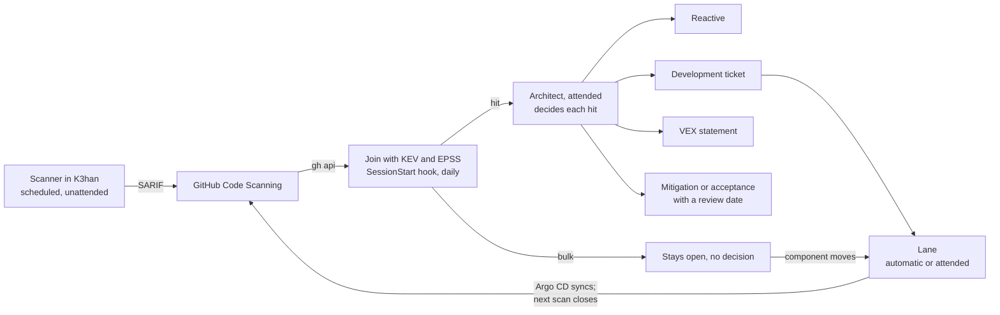

# K3han Operations (Script)

> **Type**: Script
> **Focus**: How the K3han platform is kept running: which work is proactive or reactive, cluster or host, and what carries each step of detection and triage.
> **Constraint**: A fix is a Development ticket and follows the [Development](safechord.kdd.practice.development.md) page. Alert routing is on the [monitoring page](safechord.chorde.k3han.monitoring.md); values stay in the manifests.

> **🚧 Draft.** Only the scanner (§3.1) runs, since 2026-11-03 (Chorde#40). The join (§3.2) and the lanes (§3.3) are decided and not built. The page holds what the Architect has decided, and marks the rest as open decisions. This is Chorde's operations implementation page: the [Operations](safechord.kdd.practice.operations.md) mode page draws up what holds for both SafeZone and Chorde once both run.

---

## 1. Objective & Scope

Two criteria sort K3han operations work.

- **Proactive or reactive: is something wrong now?** Proactive work keeps the platform from breaking while nothing is broken; reactive work starts when something is. A CVE is proactive unless there is evidence that it is exploited against an exposed component, when it becomes reactive (§3.2).
- **Cluster or host: where does the action land?** Cluster: on objects in the cluster, declared in `Chorde/gitops/` and applied by ArgoCD. Host: on a node: OS packages, kernel, sysctl and Tailscale, declared in `Chorde/cluster/k3han/ansible/` and applied by the playbook or the node's package manager; and k3s. k3s is host work although its target version is declared in `Chorde/gitops/` as a System Upgrade Controller Plan: the Plan's Job replaces the binary on the node and restarts k3s there, the node leaves service while it does, and k3s does not go back to an earlier version. Neither where an item is declared nor where its detection runs classifies it: node patch state is measured in the cluster and is host work.

The workstation toolchain (argocd, helm, kubeseal, promtool, logcli) is in neither layer; its versions follow the cluster's.

Open decision: the reactive side (triage entry, mitigation runbooks) and host-layer detection are not designed.

## 2. Actors & Tools

| Actor / Tool | Responsibility | Type |
| :--- | :--- | :--- |
| **Scanner in K3han** | Scans the images running in the cluster on a schedule | Automation, unattended |
| **GitHub Code Scanning** | Holds each finding's state (open, fixed, dismissed) across scans; the only record of a bulk finding (§3.2) | Service |
| **Alertmanager → Slack** | Reports a scan that failed (§4) | Automation, unattended |
| **SessionStart hook** | Runs the join (§3.2) at most once a day and prints the unhandled hits | Automation, human-woken (not built) |
| **The Architect** | Decides each hit (§3.2); merges attended upgrades in the maintenance window (§3.3) | Human, attended session |
| **Update bot** | Opens a bump PR for each component release; merges the automatic lane's (§3.3) | Automation, unattended (not built) |
| **Development** | Fixes, through a ticket | Mode |

## 3. Proactive Detection and Triage

Every proactive item runs detect → triage → fix: a hit through a Development ticket, bulk through its component's lane (§3.3). Operations owns detection, triage, the lanes and live actions; it does not own the fix.

### 3.1 Detection

- **The scanner runs inside K3han**, unattended, on a fixed schedule, and scans the images that are running rather than those declared in `gitops/`: what runs is what is exposed. It takes every pod the API lists, init containers and completed CronJob pods included, and scans each image by the digest its node resolved, so a tag that moved is not scanned in its place. It never runs on `gce-agent-tw`, whose allocatable memory is about 1 GiB. It leaves out the `safezone` namespace: SafeZone's operations is a block of its own, and its images are private on ghcr, so scanning them takes a pull credential and a findings repository that are SafeZone's to choose. SafeZone may join later.
- **It is a CronJob running the trivy CLI at a pinned version**, in `Chorde/gitops/k3han/kustomize/vuln-scan/`, deployed by the `Application` in the platform stage's `vuln-scan/` directory ([Chorde](safechord.chorde.md) §4, item 2). The CLI reads VEX and writes SARIF itself; trivy-operator does neither, and would need a converter larger than the CronJob. The vulnerability database is fetched at each run, so the pin holds the scanner's behaviour still without holding back new CVEs.
- **Its logic is plain files in that directory**, packed into a ConfigMap by kustomize's `configMapGenerator`: the script stays testable on its own and needs no image build.
- **The VEX statements are a SealedSecret in that directory**, sealed from a plaintext file in the workspace harness: a statement records which flaws K3han judged unreachable, and Chorde is public. Like every unsealed secret, the plaintext is not tracked in Git ([Security](safechord.security.md), Secret Management): the statements in force are also the cluster's Secret, and earlier ones are the SealedSecret's history in Chorde, readable with the sealing key backup. The command that reseals it heads the directory's `kustomization.yaml`. A statement takes effect at the next scan after its PR syncs. A Secret holds at most 1 MiB, and while the application syncs with client-side apply, its last-applied annotation caps it at 256 KiB (not tested on K3han); statements exist only for hits (§3.2), which keeps them far below that.
- **Findings go to GitHub Code Scanning as SARIF**, which keeps each finding's state across scans: an alert closes when a scan no longer reports it, reopens when it returns, and keeps its dismissal. Its alerts are not readable by the public on a public repository (tested on Chorde, 2026-09-09).
- **One alert is one CVE in one package of one image repository.** The rule is the CVE ID; the location is `<image repo>/<package>`, with no registry, tag or version, rewritten from trivy's, which carries a Python package's version in its path. An upgrade that leaves the CVE in place keeps the alert: re-assessment on upgrade is the job of a VEX statement bound to the image digest (§3.2). Two tags of one repository running at once share an alert.
- **It runs once a week and keeps HIGH and CRITICAL findings, those without a fix included.** The join (§3.2) reads every open finding, and one without a fix can still gain a signal, so dropping it would hide the hit.
- **The scanner uploads as a GitHub App**, installed on Chorde alone with write access to code scanning alerts. Each run mints an installation token, valid for an hour, from the App's private key, stored as a SealedSecret ([Security](safechord.security.md)): no credential expires between runs.
- **An image the scanner cannot analyse becomes a `vuln-scan/not-covered` alert** in Code Scanning, at the image repository, never a clean result. The alert closes once a scan covers the image. A clean result can still mean nothing was seen: `busybox:1.33` reports zero findings because trivy detects no packages in it.

Open decisions:

- Detection at change (a gate on a Chorde PR that changes an image tag) and the support-window trigger (a component leaving its vendor's support).

No alert from the 2026-09-09 test came back on the first upload (2026-11-03): their rule and location differ from the scanner's.

### 3.2 Triage

**Triage handles the exceptions; the rest rides.** A finding needs a decision from the Architect only when a signal says it may matter here: it is then a **hit**. Every other finding is **bulk**, and its default needs no decision. One outcome per finding was the earlier rule, and its work grew with the scanner database rather than with anything that moved: the first sweep (2026-11-06) wrote 2276 rows, and one database update on 2026-11-12 added 146 alerts with no image moved. It also missed the one finding that mattered: a KEV-listed flaw on fluent-bit, recorded as waiting upstream while a release that drops it had been out for a week (Chorde#103).

**The join.** A script in the workspace harness joins **every open finding** with the CISA KEV catalogue and the EPSS scores: all of them, not only the new ones, because a finding can gain a signal weeks after it was first seen. A SessionStart hook runs it at most once a day and prints one line when there are unhandled hits, and nothing otherwise; it does not run in a session a script started. A feed that cannot be fetched fails the join loudly: a join that did not run never reads as no hits. A CVE with no EPSS score yet is rejoined the next day. Not built.

A finding is a hit when any of these holds:

1. It is listed in CISA KEV.
2. Its EPSS score is 0.10 or more.
3. It is critical and on an edge component: cloudflared, nginx-gateway-fabric, or a workload on `public-gateway` (today echo-server). The workloads on `private-gateway` are not edge: Cloudflare Access stands in front of them (checked 2026-11-16), and KEV and EPSS still apply to them. The list is kept by hand, so a new public route is added to it.

The thresholds were set by replaying the rule on the four scans up to 2026-11-13: 12 advisories on the first scan, 2 after the first upgrade round. Whether they hold on later scans is not established.

**A hit is decided by the Architect** in an attended session, by these questions in order:

| Question | Yes |
| :--- | :--- |
| Is it exploited against an exposed component here? | Reactive |
| Does a release of the component drop it? (scan that release) | A Chorde ticket to move the component to it now, through its lane (§3.3), waiting for no round |
| Is it unreachable here, and not KEV-listed? | A VEX statement |
| None of the above | A mitigation, or an acceptance with a review date; the alert stays open |

**A KEV-listed hit is not closed on a reachability argument.** KEV already answers whether the flaw is exploited; a reachability argument assumes an attacker who starts outside and a configuration that stays as it is, and fails once either changes. The only statement allowed on a KEV-listed finding is that the flawed code is not in the image. Reachability sets the speed instead: reactive when exposed, otherwise moved by CISA's due date (§3.3). With no release to move to, the hit is mitigated and its alert stays open.

**A VEX statement binds to the image digest**: its product is the image as an OCI package URL with the digest, and the flawed packages are its subcomponents. A statement on a package alone would apply to every image that carries the package, including images where the flaw may be reachable. **It is checked before it is sealed**, with trivy at the scanner's pin on the running digest: the finding goes and the image's other findings stay. trivy (#9465, seen on 0.76.1) does not apply an image-scoped statement to a package whose dependency path reaches a cycle, so a statement that reads correctly can still leave its finding open. A triage removes the statements bound to digests that no longer run.

**Bulk stays open in Code Scanning, which is its record.** No bulk finding gets an outcome, a row or a statement: it closes when its component moves (§3.3). A finding with no fixed release stays bulk until it becomes a hit. The open total therefore stays in the hundreds and follows the scanner database; what is watched is the unhandled hits.

**The record.** A triage that had a hit or a decision writes one record in `.ai-security/` in the workspace harness, which is private. A hit is handled once a record names its ticket, statement or review date, and the join reads the records to tell handled hits from unhandled ones. A day with no hit writes nothing. A Chorde ticket for a hit states the finding as `Chorde/.ai-rules.md` §5 asks; the reachability evidence stays in the record, since Chorde is public.

**A `vuln-scan/not-covered` alert (§3.1) is not a hit** (Architect, 2026-11-17): the join reads CVEs, and that alert carries none. It stays open in Code Scanning until a scan covers the image, and nothing wakes anyone for it. None was open on 2026-11-17.

**An unattended path for hits** (the scanner flags a KEV-listed finding on an exposed component, and Slack wakes the Architect) is an open decision, settled with the scanner once the zot registry runs (Chorde#102): whether the scanner changes is decided then.

### 3.3 Lanes and the Maintenance Window

K3han builds none of these images: the only fix within reach is a move of the component's version, and one move can close findings across several of its images. trivy's fixed version is the package's, not the component's: whether a release of the component drops a finding is learned by scanning that release.

A component moves by one of two lanes, sorted by what its roll costs, not by any finding. Every platform workload runs one replica, so every roll interrupts its component; what sorts them is a known cost beyond that. A major release takes the attended lane whatever the component.

| Lane | Flow | Components (patch and minor releases) |
| :--- | :--- | :--- |
| **Automatic** | The update bot opens the bump PR, Chorde's checks pass, it merges after a release-age wait, Argo CD syncs. The Architect hears of it only when it fails | fluent-bit, alloy, keda, echo-server, trivy (the scanner's image), system-upgrade-controller, sealed-secrets, cloudflared |
| **Attended** | The update bot opens the bump PR; the Architect merges it in the maintenance window | cnpg-operator and cnpg-postgresql, nginx-gateway-fabric with the Gateway API CRDs, strimzi-operator and strimzi-kafka, k3s, argocd, kube-prometheus-stack, loki, valkey |

What puts each attended component there:

- **cnpg-operator, cnpg-postgresql**: a move restarts both Postgres clusters, about three minutes, and SafeZone's analytics-api answers one 500 while SafeZone#127 is open. A PostgreSQL major version does not go back; whether the operator goes back to an earlier release is not established.
- **nginx-gateway-fabric, Gateway API CRDs**: a move rolls the public data plane, and public routes are down for about 22 seconds ([Ingress](safechord.chorde.k3han.ingress.md)). The CRDs move with the controller.
- **strimzi-operator, strimzi-kafka**: raising Kafka's `metadataVersion` does not go back; a Kafka version move that leaves it unchanged does.
- **k3s**: its upgrade takes nodes out of service, and k3s does not go back to an earlier version (Chorde#64).
- **argocd**: it deploys itself, so a failed move takes the way back with it.
- **kube-prometheus-stack**: a roll drops Alertmanager's silences while it keeps them in an `emptyDir`.
- **loki**: one replica, and its ruler stops evaluating while it rolls. A new schema period cannot be undone.
- **valkey**: SafeZone staging's cache. A newer release's RDB and AOF files do not load in an earlier one, so going back empties the cache, which is accepted.

**A one-way step is its own change.** Raising Kafka's `metadataVersion` and adding a Loki schema period cannot be reverted through Git, so each is a change of its own, never in the same move as a version. A move that makes a different version of a CRD its storage version cannot be reverted either: the API server rejects the earlier CRD while objects are stored in a version it omits. Such a move takes the attended lane whatever the component, and its ticket states the way back before it syncs. sealed-secrets' keys (renewed on a timer, never by a move, and kept) and Grafana's database (no volume) were checked and are not one-way. Prometheus's TSDB from 3.x reads back to 2.55; changes to it within 3.x, argocd's state beyond its CRDs and zot's storage were not checked.

alloy, keda and system-upgrade-controller are on the automatic lane by inference; their roll costs are not established one by one.

A hit whose component has a release that drops it skips the release-age wait on the automatic lane, and is moved in the next window on the attended one.

**The maintenance window** is weekly, on Sunday during the day, before the weekly scan, so that the scan the next night checks the moves. It is skipped when no attended PR is waiting. Within it, components move one at a time, bottom-up along their dependencies: k3s before the components it bundles and the operators whose supported Kubernetes versions it moves, an operator before its operands, and kube-prometheus-stack last, since its roll drops the silences set for the window. Each move is checked before the next, and the window stops at the first that fails. A KEV-listed hit that is not exposed moves in the last window before CISA's due date, or in a window opened for it when none falls before; an exposed one is reactive and waits for no window. Each dependency is the upgrade ticket's blocked-by relation on GitHub.

The update bot does not exist: Chorde has no update bot and no CI, and its checks in `scripts/test/` are run by hand. Until it runs, the Architect calls a round of moves in the window, through Development tickets. Open decisions: the bot, the release-age wait and the CI that runs the checks, settled after the zot registry (Chorde#102); which release the bot proposes for a component whose upstream maintains older lines (k3s, PostgreSQL, Kafka): its latest, or the newest of a supported older line, as K3han runs today; and how a bot's bump PR relates to a Development ticket.

### 3.4 After the Merge

| Layer | After the fix merges |
| :--- | :--- |
| Cluster | ArgoCD syncs `main` |
| Host | The playbook runs; a live action by the Architect may follow, such as a reboot |

k3s is host work that a sync applies: ArgoCD syncs its Plan, and the System Upgrade Controller upgrades the nodes. How that run is attended is an open decision (Chorde#64).

## 4. Convergence & Resilience

- **Automation boundary.** Detection runs unattended. The join is human-woken, and so is everything a hit leads to while every lane is attended in practice (no update bot runs): a join that woke no one sooner would gain nothing. The fix goes through Development. When the update bot runs, the join is reconsidered with the scanner (§3.2).
- **A detection that stops reads as a quiet week.** A failed scan, an expired credential or a rejected upload leaves Code Scanning looking clean. So any of them fails the scanner's Job, and kube-prometheus-stack's `KubeJobFailed` reaches Slack through Alertmanager's default route ([Monitoring](safechord.chorde.k3han.monitoring.md)). The finished Job is removed after a day, so the alert resolves rather than repeating until the next run. A channel of its own waits until this route proves too noisy.
- **A GitHub error that may pass does not cost the week.** GitHub answers now and then with a 5xx: a run on 2026-11-08 lost its upload to one 502, and the same payload went through minutes later. Within a run, each call to GitHub (the token, the head of `main`, the upload, the processing status) is retried with growing waits on a 5xx, a 429, a connection that fails or a request that goes unanswered, for up to an hour, with a fresh token once the old one is ten minutes from expiry. A request counts as unanswered once a minute has passed since it started, its upload included: GitHub ends any request it takes more than ten seconds to process, and an upload of the largest size the scan has sent (about 300 KB) took under a second, measured from a workstation rather than from K3han. With no bound, a request that hangs holds the run until the Job's `activeDeadlineSeconds` ends it, and the week's scan is lost though GitHub may answer the next request; with it, a run whose every request hangs gives up a little over an hour after its first. A connection that fails is one curl reports as unable to resolve, connect or finish its TLS handshake, or as cut off mid-answer, HTTP/2 stream and framing errors included; any other curl error, such as a file it cannot read or write, is not GitHub's and fails the run at once, as does any other answer. The waits grow from seconds to a few minutes; the last is cut to the end of the hour and ends in one more request, so a run gives up at its last request, never after a wait. A failed run's last log line names the call and GitHub's HTTP status, or curl's error, which for an unanswered request says so. A run whose retries run out fails as above, and the scan is run again rather than its payload kept: a scan takes minutes, and a new one reports what runs now. Re-sending an upload is safe, since an analysis replaces the last one of its category.
