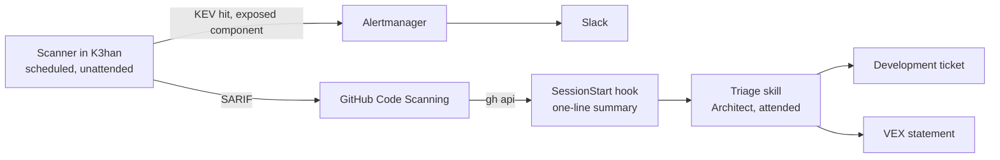

# K3han Operations (Script)

> **Type**: Script
> **Focus**: How the K3han platform is kept running: which work is proactive or reactive, cluster or host, and what carries each step of detection and triage.
> **Constraint**: A fix is a Development ticket and follows the [Development](safechord.kdd.practice.development.md) page. Alert routing is on the [monitoring page](safechord.chorde.k3han.monitoring.md); values stay in the manifests.

> **🚧 Draft.** Only the scanner (§3.1) runs, since 2026-11-03 (Chorde#40). The page holds what the Architect has decided, and marks the rest as open decisions. This is Chorde's operations implementation page: the [Operations](safechord.kdd.practice.operations.md) mode page draws up what holds for both SafeZone and Chorde once both run.

---

## 1. Objective & Scope

Two criteria sort K3han operations work.

- **Proactive or reactive: is something wrong now?** Proactive work keeps the platform from breaking while nothing is broken; reactive work starts when something is. A CVE is proactive unless there is evidence that it is exploited against an exposed component, when it becomes reactive (§3.3).
- **Cluster or host: where is the desired state declared?** Cluster: in `Chorde/gitops/`, applied by ArgoCD. k3s is cluster work, because its upgrade is a System Upgrade Controller Plan there. Host: in `Chorde/cluster/k3han/ansible/`, applied by the playbook or the node's package manager: OS packages, kernel, sysctl, Tailscale. An item is classified by where its action lands, not where its detection runs: node patch state is measured in the cluster and is host work.

The workstation toolchain (argocd, helm, kubeseal, promtool, logcli) is in neither layer; its versions follow the cluster's.

Open decision: the reactive side (triage entry, mitigation runbooks) and host-layer detection are not designed.

## 2. Actors & Tools

| Actor / Tool | Responsibility | Type |
| :--- | :--- | :--- |
| **Scanner in K3han** | Scans the images running in the cluster on a schedule | Automation, unattended |
| **GitHub Code Scanning** | Holds each finding's state (open, fixed, dismissed) across scans | Service |
| **Alertmanager → Slack** | Carries the urgent lane (§3.3) | Automation, unattended |
| **SessionStart hook** | Summarises open findings when a Claude Code session starts | Automation, human-woken |
| **The Architect**, with a triage skill | Decides, one component at a time, what its new findings call for (§3.2) | Human, attended session |
| **Development** | Fixes, through a ticket | Mode |

## 3. Proactive Detection and Triage

Every proactive item runs detect → triage → ticket → Development. Operations owns detection, triage and live actions; it does not own the fix.

### 3.1 Detection

- **The scanner runs inside K3han**, unattended, on a fixed schedule, and scans the images that are running rather than those declared in `gitops/`: what runs is what is exposed. It takes every pod the API lists, init containers and completed CronJob pods included, and scans each image by the digest its node resolved, so a tag that moved is not scanned in its place. It never runs on `gce-agent-tw`, whose allocatable memory is about 1 GiB. It leaves out the `safezone` namespace: SafeZone's operations is a block of its own, and its images are private on ghcr, so scanning them takes a pull credential and a findings repository that are SafeZone's to choose. SafeZone may join later.
- **It is a CronJob running the trivy CLI at a pinned version**, in `Chorde/gitops/k3han/kustomize/vuln-scan/`, deployed by the `Application` in the platform stage's `vuln-scan/` directory ([Chorde](safechord.chorde.md) §4, item 2). The CLI reads VEX and writes SARIF itself; trivy-operator does neither, and would need a converter larger than the CronJob. The vulnerability database is fetched at each run, so the pin holds the scanner's behaviour still without holding back new CVEs.
- **Its logic is plain files in that directory**, packed into a ConfigMap by kustomize's `configMapGenerator`: the script stays testable on its own and needs no image build.
- **The VEX statements are a SealedSecret in that directory**, sealed from a plaintext file in the workspace harness: a statement records which flaws K3han judged unreachable, and Chorde is public. Like every unsealed secret, the plaintext is not tracked in Git ([Security](safechord.security.md), Secret Management): the statements in force are also the cluster's Secret, and earlier ones are the SealedSecret's history in Chorde, readable with the sealing key backup. The command that reseals it heads the directory's `kustomization.yaml`. A statement takes effect at the next scan after its PR syncs. A Secret holds at most 1 MiB, and while the application syncs with client-side apply, its last-applied annotation caps it at 256 KiB (not tested on K3han); triage keeps the statements below that (§3.2).
- **Findings go to GitHub Code Scanning as SARIF**, which keeps each finding's state across scans: an alert closes when a scan no longer reports it, reopens when it returns, and keeps its dismissal. Its alerts are not readable by the public on a public repository (tested on Chorde, 2026-09-09).
- **One alert is one CVE in one package of one image repository.** The rule is the CVE ID; the location is `<image repo>/<package>`, with no registry, tag or version, rewritten from trivy's, which carries a Python package's version in its path. An upgrade that leaves the CVE in place keeps the alert: re-assessment on upgrade is the job of a VEX statement pinned to a version. Two tags of one repository running at once share an alert.
- **It runs once a week and keeps HIGH and CRITICAL findings, those without a fix included.** A finding without a fix leaves triage as a VEX statement (§3.2), so dropping it would hide the decision it needs.
- **The scanner uploads as a GitHub App**, installed on Chorde alone with write access to code scanning alerts. Each run mints an installation token, valid for an hour, from the App's private key, stored as a SealedSecret ([Security](safechord.security.md)): no credential expires between runs.
- **An image the scanner cannot analyse becomes a `vuln-scan/not-covered` alert** in Code Scanning, at the image repository, never a clean result. The alert closes once a scan covers the image.

Open decisions:

- Detection at change (a gate on a Chorde PR that changes an image tag) and the support-window trigger (a component leaving its vendor's support).

No alert from the 2026-09-09 test came back on the first upload (2026-11-03): their rule and location differ from the scanner's.

### 3.2 Triage

Triage is human-woken. The SessionStart hook reads Code Scanning with `gh api` and prints one line: how many findings are new since the last triage, and how many of them are critical. It prints no list, because it runs at the start of every session, whatever the session is for.

The Architect triages in an attended session, with a triage skill, one component at a time: an application in `gitops/` whose images run in the cluster. The component is the unit because K3han builds none of these images, so the only fix within reach is a move of the component's version, and one move can close findings across several of its images. trivy's fixed version is the package's, not the component's: whether a release of the component drops a finding is learned by scanning that release.

Each finding of the component leaves as one of:

| Outcome | When | Next |
| :--- | :--- | :--- |
| **Ticket** | A release of the component no longer carries the finding | A Chorde ticket to move the component to that release, through Development. It names the upgrade and the triage record, never the findings: Chorde is public |
| **VEX statement** | The flaw is not reachable here | A `not_affected` OpenVEX statement in `vuln-scan/`, applied at scan time. A statement pinned to a version expires when the component is upgraded, which forces a fresh assessment |
| **Waits upstream** | No release of the component carries a fix, and the flaw is reachable | Recorded in the triage record alone; the alert stays open |
| **Reactive** | Exploited against an exposed component | §3.3 |
| **Not covered** | The scanner cannot analyse the image | Recorded as not covered, never as clean. `busybox:1.33` reports zero findings because trivy detects no packages in it |

Each triage writes a record in `.ai-security/` in the workspace harness, which is private: the components triaged, the findings each covers and the outcome of each. The records mark the last triage: a finding is new when no record lists it. A triage also removes the VEX statements pinned to versions that no longer run.

Triage takes components in no particular order: on the first scan nearly every image carried a critical finding, so severity sorts nothing, and the urgent lane (§3.3) carries what cannot wait. Upgrades go bottom-up along their dependencies: k3s before the components it bundles and the operators whose supported Kubernetes versions it moves, an operator before its operands. Each dependency is the upgrade ticket's blocked-by relation on GitHub.

The triage skill does not exist yet.

### 3.3 Urgent Lane

A finding listed in CISA KEV, on an exposed component, skips triage: the scanner exposes it as a metric, Alertmanager sends it to Slack, and it is handled as reactive work.

Open decision: how "exposed" is derived, and which Slack channel the lane uses.

### 3.4 After the Merge

| Layer | After the fix merges |
| :--- | :--- |
| Cluster | ArgoCD syncs `main` |
| Host | The playbook runs; a live action by the Architect may follow, such as a reboot |

## 4. Convergence & Resilience

- **Automation boundary.** Detection and the urgent lane run unattended. Triage waits for the Architect. The fix goes through Development.
- **A detection that stops reads as a quiet week.** A failed scan, an expired credential or a rejected upload leaves Code Scanning looking clean. So any of them fails the scanner's Job, and kube-prometheus-stack's `KubeJobFailed` reaches Slack through Alertmanager's default route ([Monitoring](safechord.chorde.k3han.monitoring.md)). The finished Job is removed after a day, so the alert resolves rather than repeating until the next run. A channel of its own waits until this route proves too noisy.
