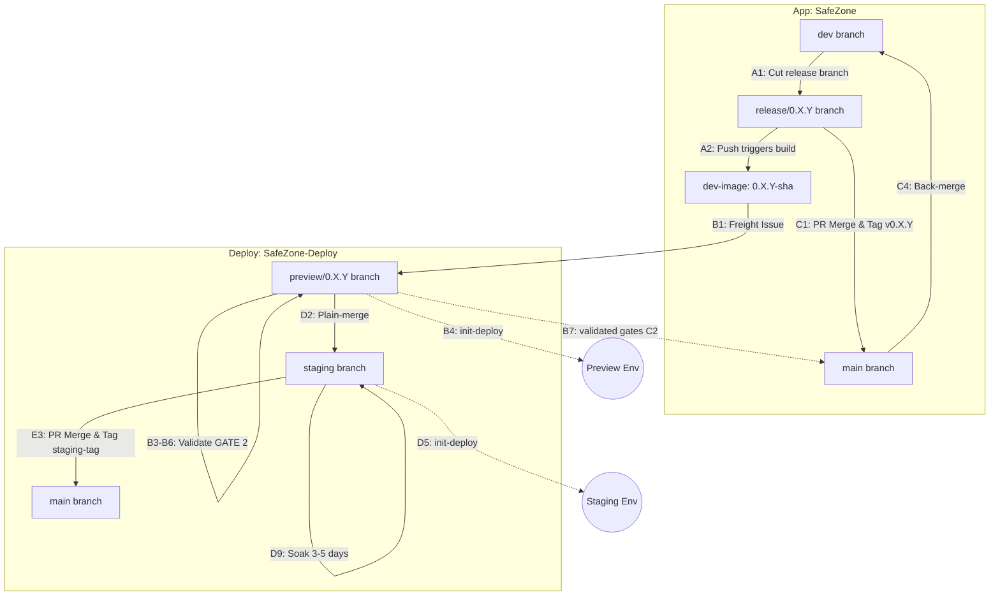

# SafeZone Delivery (App + Deploy)

> **Type**: Script (a project implementation page: assembles the components of the shared [delivery mode page](safechord.kdd.practice.delivery.md))
> **Focus**: How a SafeZone release is cut, validated in preview, promoted to staging, soaked and archived, across `SafeZone` (App) and `SafeZone-Deploy` (Deploy), and why it is shaped that way.
> **Constraint**: Nothing every project's delivery holds (the gate, floor and focus, what Development hands over): it is on the shared page. What a check runs is in its `validate-*` skill (`.claude/skills/` in the workspace harness); what a pipeline does, and the commands, are in its workflow file and scripts.

---

**PART I — THE FLOW** *(what you do)*

## 1. Repos, branches and skills

**App `SafeZone` — GitFlow**
| Branch | Role / Action |
| :- | :- |
| `feature/*` | Feature development (local) |
| `dev` | Integration trunk — runs CI checks (GATE 1) |
| `release/*` | **Release branch — single-use** (cut from dev to isolate release; no new features. Receives hotfix PRs ➡️ runs GATE 1. Frozen/retired after tagging; post-GA defects do not reopen this branch) |
| `main` | Production trunk — merges `release/*` and tags `v*.*.*` |

**Deploy `SafeZone-Deploy` — GitOps Branches**
| Branch | Environment | ArgoCD Sync Target |
| :- | :- | :- |
| `preview/<ver>` | Dev & in-cluster validation (ephemeral; re-cut from staging) | `targetRevision=preview/<ver>` |
| `staging` | Soak + persistent showcase | `targetRevision=staging` |
| `main` | Golden config archive (history only, no sync) | — |

**Skills** (`.claude/skills/` in the workspace harness):

| Skill | When | What it does |
| :--- | :--- | :--- |
| `validate-freight` | B5 | Verifies a preview candidate; on the human's yes, stamps its freight issue `validated` (B5–B7) |
| `validate-release` | D6 | Verifies staging after promotion; on the human's yes, stamps the `release` issue (D6–D8) |
| `validate-soak` | E1, and a scoped re-soak (§3) | Certifies the soak window; on the human's yes, ticks the soak item on the `release` issue |
| `issueops` | Once a candidate is pushed, and once a release is tagged | Opens the `freight` and `release` issues under the titles and labels the release pipeline reads, and links the release record ticket to the `release` issue. **Not built yet**: until it is, `publish-candidate.yml` and `release.yml` open them |

## 2. The pipeline — Phase A–E

### Phase A — App integration (`SafeZone`)
- **A1.** Confirm that `main` is an ancestor of `dev`: a release started before the prior version is back-merged would leave its fixes orphaned. Cut `release/0.X.Y` from `dev`, bump the App `VERSION` file to the target version on the release branch, add the version's section to `CHANGELOG.md`, and commit the change (e.g., `chore(release): open v0.X.Y`).
- **A2.** Push `release/0.X.Y` to remote. This push triggers `publish-candidate (GitHub Action)` to build and push the OCI images.
- **A3.** Open the `freight: 0.X.Y-<sha>` issue with `issueops`.

### Phase B — Preview validation (`SafeZone-Deploy`)
- **B1.** Pick up the `freight: 0.X.Y-<sha>` issue. Cut `preview/0.X.Y` from `staging` and push it before any Deploy ticket triaged from the freight issue starts: the ticket branches from it.
- **B2.** Author configurations on the preview branch. Update target image tags and env values for both `preview` and `staging` charts ➡️ **push the branch**. Staging's values are set here, not when staging comes up, so that they are tested with the release and promoted in the same merge (D2).
- **B3.** Bring up the preview infrastructure.
- **B4.** Trigger the `init-deploy.yml` action (env=preview).
- **B5.** Run `/validate-freight`: the floor and preview's focus.
- **B6.** Wait for the human to sign off or reject, after their visual check. A rejection ends the gate; the fix returns as a new candidate (§3).
- **B7.** On sign-off, `/validate-freight` stamps the `validated` label on the freight issue. *Open decision*: whether the agent's verification and the human's sign-off get labels of their own, so the agent's run does not wait on the human. It waits on the rendering check being automated: the gateway log scan needs browser traffic, which today only the human's check makes.
- **B8.** Teardown the preview environment (app first, then infra).

### Phase C — Cut the release (`SafeZone`, only after `validated`)
- **C1.** Merge the PR from `release/0.X.Y` into `main` (a merge commit, no squash: `release.yml` takes the validated sha from its second parent) and tag `v0.X.Y`.
- **C2.** The tag runs `release.yml`, which refuses a candidate without a `validated` freight issue, copies its images to `0.X.Y` by digest, and opens the back-merge PR. Copying the digest instead of rebuilding ships exactly what preview validated; a rebuild can pick up a floating base tag or a newer upstream package.
- **C3.** Open the `release: v0.X.Y` issue with `issueops`.
- **C4.** Merge the back-merge PR into `dev` before the next `release/*` is cut, so that no release fix is orphaned.

### Phase D — Staging deploy + soak (`SafeZone-Deploy`)
- **D1.** Teardown the existing staging environment (leave external / platform services). A rebuild holds while schemas and platform networking still break between releases: backward-compatible migrations and a rolling update for every release would cost more than a clean rebuild, which recovers in under 10 minutes. Revisit it once migrations stay backward compatible.
- **D2.** Plain-merge `preview/0.X.Y` directly into `staging` (no PR, no staging promotion branch). No PR holds while the project has one developer: GATE 2 has already validated the config in the cluster, a PR would add a step with no second reviewer, and the merge commit and the release issue keep the audit trail.
- **D3.** Adjust staging environment deltas (env deltas) on the `staging` branch ➡️ **push the branch**.
- **D4.** Bring up the staging infrastructure.
- **D5.** Trigger the `init-deploy.yml` action (env=staging).
- **D6.** Run `/validate-release (AI Skill)`. 
- **D7.** Human verifies (UI + external connectivity).
- **D8.** On the human's yes, `/validate-release` posts its evidence on the `release: v0.X.Y` issue and labels it `soaking`, which starts the soak.
- **D9.** Soak (3–5 days).

### Phase E — Archive (`SafeZone-Deploy`)
- **E1.** Run `/validate-soak` (soak data freshness check pending design).
- **E2.** Confirm all `release: v0.X.Y` checklist items are done.
- **E3.** Tag `v0.X.Y-staging` on `staging` + PR `staging` → `main` (archive).
- **E4.** Close the `release: v0.X.Y` issue.
<這裡好像跟 C 同個症頭 我覺得要思考一下 這些 GIT 操作到底是怎樣呈現>

## 3. Fixes found during a release

A fix found during a release is a Development ticket (the shared page's §3). This section says only where its branch is cut and merged, and where the release picks it back up. When it was found decides both; what it changes matters only during the soak. What a merge into each branch sets off is in that repository's `.ai-rules.md` (Merging).

| When | Defect in | Ticket branches from and merges into | Release resumes at |
| :--- | :--- | :--- | :--- |
| A2–B7: the candidate is under validation | App code or schema | `release/0.X.Y` | A2: the merge is the push that builds a new candidate |
| A2–B7 | Deploy configuration | `preview/<ver>` | B2 |
| B7–C1: validated, not yet tagged | App code or schema | `release/0.X.Y` | A2. Close the old freight issue by hand: it carries `validated`, so nothing else closes it |
| B7–C1 | Deploy configuration | `preview/<ver>` | B2 |
| C1–D2: tagged, staging not yet promoted | App code or schema | `release/0.X.(Y+1)`, cut from the tag `v0.X.Y`, never from `dev`. The tagged `release/0.X.Y` is never reopened | A1 of the patch release Y+1 |
| C1–D2 | Deploy configuration | `preview/<ver>` | B2, then D1 |
| D2–E4: soaking | App code or schema | `release/0.X.(Y+1)`, as above | A1 of Y+1. Close the `release: v0.X.Y` issue as `superseded-by v0.X.(Y+1)` |
| D2–E4 | Border configuration (ingress, DNS, NetworkPolicy) | `preview/<ver>`, cut again from `staging` | B2; the soak restarts after D2 |
| D2–E4 | Chart templates, or per-environment objects (`deploy/<env>/`) | `staging` | No step: read back each changed object on the ticket, then run a scoped re-soak |
| D2–E4 | A values tweak (a non-critical environment variable, a resource limit, scaling) | None: committed to `staging` directly and logged on the `release` issue | No step: run a scoped re-soak |

- **Chart templates and per-environment objects** skip preview: per-environment objects are not promoted, so preview cannot verify staging's. The PR's evidence is each environment's `helm template` diff and a server dry-run of the per-environment objects; its Merge Danger states which workloads roll and which hooks re-run. *Open decision*: how a change to an environment that is not running (usually preview) is flagged, so that the next release's B1 knows to suspect it.
- **A values tweak** is the one path with no ticket. *Open decision*: whether it becomes a ticket too.
- A change to nothing that runs on `staging` (SafeZone-Deploy `.ai-rules.md` §4) merges as any ticket does and leaves the soak running.

**Scoped re-soak.** The 3–5 day timer is not reset. The window covers at least two complete cycles of a scheduled task (48 hours for a daily scheduler), or 6 to 12 hours of a continuous service. `/validate-soak` certifies it.

**Staging rescue**: see [6. Rollback & recovery](#rollback-recovery).

---

**PART II — THE RATIONALE** *(why it's shaped this way)*
## 4. Deployment model — hybrid + prerequisites
*This is **not** pure GitOps. Two halves: an imperative branch-promotion flow (GitHub Actions + PRs/tags) layered on GitOps reconciliation.*

- **ArgoCD owns steady-state reconcile.** Each `deploy/<env>/app/*.yaml` is an auto-sync `Application` (`targetRevision` = the env branch; `path` = `helm-charts/safezone-<layer>` + `values-<env>.yaml`). Helm renders **inside ArgoCD**, not as a CI pre-step.
- **Ordering, by layer** — ArgoCD's health-driven sync-waves don't span Applications or reliably gate Jobs:
  - **Infra** → ArgoCD-native **sync-waves** on the `ApplicationSet`.
  - **App** → **`init-deploy.yml`** applies the Application CRs in order and gates between phases on rollout and Job health; the order is in the workflow. A phased *bootstrapper + gate*, not an imperative deployer — once a CR exists, ArgoCD reconciles it. A pure ArgoCD path, with sync waves and Job hooks, was tried first: waves and hooks were seen to move on before the Jobs had finished, so schema seeding and smoke tests went ungated. Why ArgoCD took the Jobs as done is not established.

## 5. Versioning — Decoupled Evolution Strategy
App and Deploy version numbers drift independently to reflect their respective release units:
*   **App Repo (`SafeZone`)**: VERSION is defined in `/SafeZone/VERSION` (governed by the corresponding GitHub Milestone aggregating the target cycle's issues). It bumps on code changes. Images are tagged with `appVersion` (e.g., `0.3.6`).
*   **Deploy Repo (`SafeZone-Deploy`)**: Config version is defined in all sub-charts' `Chart.yaml` `version` fields. Only the human bumps it, when they judge a change a cut worth marking (SafeZone-Deploy `.ai-rules.md` §2), until each environment pins chart versions of its own or the bump is automated without side effects. `appVersion` in `Chart.yaml` acts as the pointer to the target App image tag. *(Note: The library chart `safezone-common` has its `appVersion` pinned to `"1.0.0"` and does not participate in this image tag drifting.)*
*   **`VERSION` bump discipline**: 
    - At the start of a release cycle (Step A1), the App `VERSION` file is bumped directly on the `release/*` branch to set the target version (e.g., `0.3.7`), ensuring a frozen-pin semantic for the release codebase. All dev images generated during this cycle will use this version as a prefix (`0.3.7-<sha>`).
    - **Guards**: To prevent human error, the release pipeline (`release.yml`) automatically fails if the finalized Git tag (e.g., `v0.3.7`) does not match the content of the App `VERSION` file. Additionally, the release is always cut from a dedicated `release/*` branch (acting as a **frozen pin** for that version's codebase), guaranteeing that no unvalidated changes bypass the release gate.

*   **Tags**: `0.X.Y-<sha>` (Preview images) · `0.X.Y` (Official App release image) · `v0.X.Y` (Git release tag) · `v0.X.Y-staging` (Rescue baseline).

## 6. Rollback & recovery {#rollback-recovery}
*   **Forward-fix only**: The project does not support automated rollback; issues are addressed by shipping forward fixes.
*   **Staging Rescue**: In case of staging environment failure, the ArgoCD `targetRevision` may be temporarily pinned to a known good release tag (`v0.X.Y-staging`) to restore showcasing functionality while a forward-fix is prepared.
